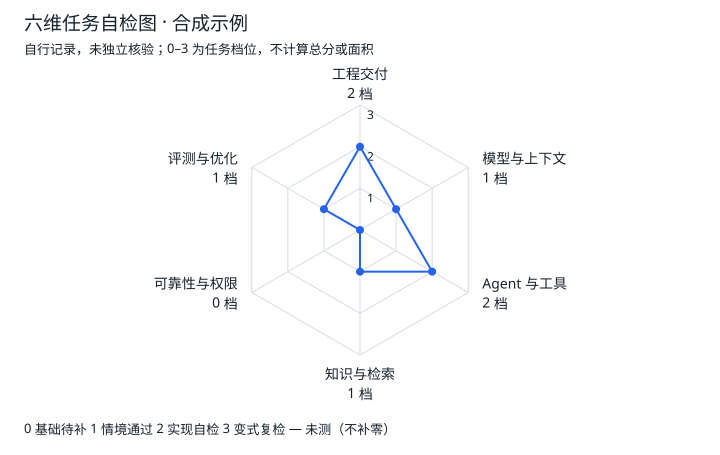

# 六维能力自检：产品与实施方案

设计版本：0.1 · 2026-10-11 · 状态：**方案已收敛，正式测评尚未实现或上线**。

本轮完成三轮方案讨论、六轴定义、评分规则、12 个任务蓝图及结果示意。题目定稿、真实用户试评、页面开发与发布是后续工作；下文所有分数都是说明设计的合成示例。

目标是回答三个学习问题：当前哪些任务能独立完成？缺口由什么证据支持？下一次应该学、做、复习什么？结果接入现有 [学习主线](../roadmap/milestones.md) 和 [四条岗位路线](../paths/README.md)，不增加 102 道来源面经题的计数。

## 核心决定

采用固定六轴、0–3 档和独立的“未测”状态。主图命名为**任务自检图**；基础情境可自动核对答案，实践档位来自按量规填写的本人记录，固定显示“自行记录，未独立核验”。

| 轴 | 覆盖范围 | 与相邻轴的分界 | 补强入口 |
| --- | --- | --- | --- |
| D1 工程开发与交付 | 编程、排错、接口、存储、流式交互与端到端交付 | 关注普通工程和用户交互；模型策略由 D2 检查 | [M0](../roadmap/milestones.md#m0)、[M1](../roadmap/milestones.md#m1)、[FS-1](../paths/ai-fullstack.md#fs-1) |
| D2 模型与上下文 | 模型适配、结构输出、上下文预算、信息保留与能力边界 | 关注送给模型什么、怎样处理输出；任务调度状态由 D3 检查 | [M1](../roadmap/milestones.md#m1)、[模型基础题](../questions/09-llm-foundations.md) |
| D3 Agent 与工具 | 工具契约、执行循环、停止条件、任务状态与调用关联 | 关注合法任务如何执行；授权和副作用恢复由 D5 检查 | [M2](../roadmap/milestones.md#m2)、[AG-1](../paths/agent-engineer.md#ag-1) |
| D4 知识与检索 | 文档适用性、检索、版本、引用及证据不足 | 关注证据是否适用、支持结论；测量方法由 D6 检查 | [M3](../roadmap/milestones.md#m3)、[LLM-1](../paths/llm-application.md#llm-1) |
| D5 可靠性与权限 | 授权、幂等、并发、恢复及未知结果 | 关注不能越过的边界和故障后业务状态；关键断言跨任务保留 | [M4](../roadmap/milestones.md#m4)、[INF-1](../paths/agent-infra.md#inf-1) |
| D6 评测与优化 | 基线、样本分母、效果、延迟、成本及改进取舍 | 关注怎样证明改动有效；不因背出优化名词得到高档 | [M3](../roadmap/milestones.md#m3)、[M5](../roadmap/milestones.md#m5) |

表达不单设一轴，作为所有实践任务的解释要求和 [M6](../roadmap/milestones.md#m6) 的独立验收。每个任务只归属一个主要领域；其他领域作为关联标签，同一条断言不重复加档。

[A1–A6 入口自测](../roadmap/start.md)继续保留，尤其是 A1/A2 的编程与交付基础门槛。它不折算成雷达分，也不能被雷达分豁免。四个岗位使用同一组轴和规则；切换岗位只调整后续材料、任务优先级与 M5 分支。

## 三轮讨论与取舍

参与视角为测评内容设计、产品与实施、学习路线审查，由主代理汇总并交叉质疑。

| 轮次 | 争议与反例 | 收敛决定 |
| --- | --- | --- |
| 第一轮：测什么 | 五维需要合并模型/工程或知识/评测，容易隐藏不同短板；直接用 A1–A6 则把工具与检索、评测与表达混在一轴 | 采用六个领域，入口检查继续独立存在 |
| 第二轮：凭什么判分 | 加权平均可能让会背题抵消不会实现；静态页面无法证明粘贴的日志确实执行过 | 使用逐级必要条件，自评熟悉度不入图；情境核对与本人实践记录分别标明出处 |
| 第三轮：怎样避免误读 | 未测当 0、取历史最高分、同题看答案后新建记录、按最低轴推荐整章，都会误导下一步 | 档位/完成/复核分离；最新完整有效尝试替换；暴露记录延续；按失败判据生成小范围补课任务 |

未采用百分制、雷达面积分、岗位匹配率或排名。六边形用于快速定位领域差异；它的面积不作为统计量。也不引入“上传作品便自动认证”或模型自动判定人的工程水平。

## 结果呈现



图中数字仅展示版式。文字明细始终与图并列，包括领域、档位、来源、日期、任务版本、未通过条件。六轴齐全才连线；部分缺测仅显示已测点，不补零、不跨缺失轴连线。档位为顺序类别，不计算平均值。

结果页按以下次序组织：

1. 记录出处、测评版本、覆盖情况和较新未完成记录提示。
2. 六轴图与可读文字明细；进入单轴可查看具体任务和断言。
3. 一个主要下一步，显示“哪项未满足 → 为什么推荐 → 要提交什么”。
4. 继续任务、按变式复测、导出个人记录；历史和同伴意见独立阅读。

交互示意应覆盖五种状态：尚未开始、部分记录、仅情境判断、有作品但有关键失败、修复后完成复测。示意不接受真实答卷、不存储项目证据，也不计算用户真实能力。

## 测评单元与评分规则

### 2. 档位、完成状态、复核状态相互独立

| 字段 | 可选值 | 语义 |
| --- | --- | --- |
| `level` | `null`、0、1、2、3 | 当前完整记录满足的最高一组条件，不允许用户直接选数字 |
| `attempt_status` | `draft`、`completed` | 表示这轮材料是否填完，不表示成功或能力高低 |
| `review_status` | `unreviewed`、`peer_recorded` | 复核是追加记录，不认证、不覆盖原记录、不自动升档 |
| `mode` | `assessment`、`practice` | 练习保留反馈，但不替换当前图的完整自检记录 |

`null` 表示尚无足以判断的完整自检；0 表示已尝试但基础必需条件未满足，不能将两者画成相同中心点。
1 为“基础判断通过”；2 为“实现与自检”；3 为“不同约束下尝试、取舍与复检”。
2/3 是所填记录满足规范后的自检档，不是系统证明用户运行过程序，也不等同职级或工作年限。
每轴同时显示基础判据通过数、关键失败、记录日期、任务版本和辅助方式；档位不能代替这些事实。

### 3. 记录结构与证据门槛

一次维度记录关联 `dimension_id`、`assessment_version`、`rubric_version`、提交时间和采用的情境/实践版本。
每次任务保留 `case_family_id`、`variant_id`、内容版本、作答、反馈、辅助声明和答案暴露事件。
变式称为“不同约束下的独立尝试”，不宣传“保证未见过”；是否见过外部解答须如实申明。
实践判据不能只填一个链接或勾选通过，至少要求下表信息。

| 字段 | 要求 |
| --- | --- |
| `criterion_id` | 固定判据编号，标明是否为二档/三档必要条件以及关键失败条件 |
| `input_and_condition` | 实际输入、边界、故障条件及对应任务版本 |
| `expected` | 来自本任务规范的预期断言，不允许改写预期以适配实际结果 |
| `actual` | 实际原始输出或关键观测值；仅填“通过”不满足要求 |
| `run_status` | 未运行、已运行、运行失败；未运行不能按有运行证据处理 |
| `evidence_ref` | 文件、链接或内联记录，同时给具体行号、事件 ID 或其他定位方式 |
| `excerpt` | 与该断言相关的输出、日志或代码片段；界面截图不能替代所有执行事实 |
| `run_context` | 日期、环境、代码/数据/配置版本，区分桩、模拟数据与真实模型 |
| `explanation` | 如何从输出判断结果、本人职责、尚未验证的边界 |
| `assistance` | 查语法、AI 协作、同伴提示或主要方案由外部提供等，按实际记录 |

要求“故障或边界条件下的实际原始输出”，不要求先制造程序 bug，也不要求修复前一定失败。
原实现已经正确拒绝越权或处理重试，同样可提交真实执行结果；把本来正确的实现改坏不增加分数。
一份项目可支撑多个轴，但须分别指向不同判据；同一断言不能在同轴重复计入。
系统只检查结构完整、填报结果与断言的一致性，不把格式合格称作证据真实性核验。
可计算断言使用类型明确的观测值，例如事件序列、业务记录数、最终库存和任务状态，由页面规则比较预期；解释质量、取舍合理性等开放判据采用本人逐项判断、理由和证据定位，系统只检查填写完整，不宣称完成语义评阅。派生档位保留每项判断的来源。
同伴记录包括日期、复核任务与范围、观察到的结果和异议；未实际看过或运行的部分明确保留未核验。

### 4. 计算、辅助、答案暴露与复测

先提交完整情境回答。空白仍为进行中；明确回答“不知道”属于已作答，但对应判据未满足。
实践与变式的每个必要项须明确记录已运行结果、失败或未运行；未运行是已说明的缺口，不是假通过。
完整维度记录可以只达到基础档，但不能把尚在编辑的半份材料自动发布为本轮结论。

```text
若记录尚未完整提交：不计算替换值，保留上次完整记录、日期，并显示“本轮进行中”。
若记录属于练习或不符合独立尝试条件：保存反馈，不替换当前图。
否则从本次完整记录计算，不能在历史记录中取最高档：
  基础必需判据未全通过 -> 0；全部通过 -> 1。
  基础通过，且实践必要条件全过、有具体运行记录、无实践关键失败 -> 2。
  二档成立，且不同约束下尝试、原有回归、结果/代价取舍条件全过 -> 3。
  任何上层条件不满足，保留本次满足的最高低档；关键失败独立列出。
最后以本次完整有效自检替换该轴当前记录，历史记录仍保留可查。
```

例如本次基础通过，但幂等断言失败，结果为 1 并显示关键失败；不能用旧的 3 档遮住新失败。
首次自检尚未完成且无旧记录，仍为 `null/进行中`；已有完整记录时不能因开了新草稿把旧值抹成零。
可引用仍适用的旧项目证据，但必须在本次明确引用其版本与范围，不自动继承历史最高档。
AI 可以参与项目实现；本人解释和小改动环节需单独记录辅助方式，不能把 AI 生成说明当本人理解证据。
独立环节允许查语法；得到关键解法、针对答案的提示或由他人代做后，记为辅助练习，不作为独立复测替换依据。
已看本变式解答或针对性答案反馈后，后续同变式都属于练习；新建 `attempt` 不清除暴露状态。
答案暴露按稳定的题族/变式内容关联保存，不能仅依赖一次作答 ID；展示反馈前先保存首次提交记录。
首次完整提交后才看解答，不倒改之前记录的性质；但该变式后续重复作答不能再冒称独立复测。
变式须改变约束并调整判据，仅换名字、数字或排列不自动满足三档；内容版本改号也不自动清除暴露。
静态本地记录不能防止清空存储或虚假填报，因此本产品是学习自检，不是考试认证或身份核验。

### 5. 拟十二任务蓝图

每轴一项情境判断、一项实践，共拟十二任务；实践含三档变式。以下是待编制蓝图，不是已试评正式题。
情境判据只核对给定条件中的答案，不能从一题正确推断覆盖整个轴；具体难度和完成时间待试运行记录。
实践的所有必要断言均满足才能进入二档；各任务注明的关键失败会阻止该任务对应轴进入二/三档。

#### D1 工程开发与交付

**AT01｜情境：重连后的页面应该显示什么。** 给定同任务事件 `e1=A、e2=B、e2=B、e3=B`，并夹入旧任务迟到响应和取消请求超时。
判据：显示 `ABB`；按事件身份去重而不按文字去重；旧任务不能覆盖当前任务；未确认终态不能显示取消成功。
任务明确服务端是任务终态依据，刷新应重建已持久化结果；基础提问覆盖这里的四项判据，不考指定框架语法。
映射：[M5](../roadmap/milestones.md#m5)；[Q033](../questions/06-fullstack.md#q033)、[Q062](../questions/06-fullstack.md#q062)、[Q065](../questions/06-fullstack.md#q065)；[G04](../learning/guides/streaming-reconnect-cancellation.md)；[L02](../learning/labs/stream-replay-and-cancellation.md)。

**AT02｜实践：实现可重建的任务结果客户端。** 可用页面或 CLI 及本地服务桩，提交事件原始记录、客户端状态和重启后的读取结果；两种入口按同一组事件、持久化与终态断言判断。
二档必要条件：重复事件不重显；不同事件的同文案均保留；切换任务和客户端重建正确；取消状态来自明确终态。
关键失败：丢失不同事件、迟到结果覆盖当前任务，或仅断开连接就报告取消成功。
变式：增加两个客户端会话同时查看同一任务，并改变完成/取消确认的到达顺序；先写预测，再提交状态收敛、旧用例回归和实现代价。
映射：[M5](../roadmap/milestones.md#m5)、[M6](../roadmap/milestones.md#m6)；[Q031](../questions/06-fullstack.md#q031)、[Q065](../questions/06-fullstack.md#q065)、[Q069](../questions/07-ai-coding-evaluation.md#q069)；[G04](../learning/guides/streaming-reconnect-cancellation.md)；[L02](../learning/labs/stream-replay-and-cancellation.md)。

#### D2 模型与上下文

**AT03｜情境：一次模型请求能否按约定执行。** 题目假设输入与输出共用 1000 单位预算，已有输入 700、工具结果 150、预留输出 200。
判据：识别超出 50；压缩仍保留指定业务约束；非法结构输出不能直接执行；降低温度不能代替结构和事实检查。
预算是本题给定模型契约，不推广为所有供应商的计量规则；采用给定计数，不要求购买模型或安装 tokenizer。
映射：[M1](../roadmap/milestones.md#m1)；[Q001](../questions/01-agent-architecture.md#q001)、[Q055](../questions/09-llm-foundations.md#q055)、[Q093](../questions/02-memory-context.md#q093)；现有 G/L 无直接对应单元，不牵强挂靠。

**AT04｜实践：构建有预算与输出契约的模型适配层。** 用桩或真实模型处理成功、上游超时、非法结构及预算不足，并分别留原始输出。
二档必要条件：成功结果通过约定校验；异常有明确状态；预算处理不丢指定约束；说明模型判断和程序校验边界。
关键失败：非法结构被当作可执行结果，或必需上下文缺失时仍伪报满足业务要求；桩只能证明所模拟工程路径。
变式：工具返回长内容且夹有需保留的关键字段；预测压缩取舍，验证关键字段、失败状态和原有用例，并报告额外处理成本。
映射：[M1](../roadmap/milestones.md#m1)；[Q026](../questions/05-reliability.md#q026)、[Q055](../questions/09-llm-foundations.md#q055)、[Q093](../questions/02-memory-context.md#q093)；现有 G/L 无直接对应单元。

#### D3 Agent 与工具

**AT05｜情境：工具循环何时执行、何时停止。** 约定无效参数也消耗一次尝试，预算两次；依次出现非法参数、合法查询、第三次查询请求。
判据：非法参数在执行前拒绝；合法结果关联正确调用；第三次不执行且能指出结束原因；另一会话不能复用该任务状态。
预期实际业务查询一次；尝试计数两次。预算口径是题目明确约定，不把框架默认行为当作统一标准。
映射：[M2](../roadmap/milestones.md#m2)；[Q002](../questions/01-agent-architecture.md#q002)、[Q003](../questions/01-agent-architecture.md#q003)、[Q026](../questions/05-reliability.md#q026)；[G02](../learning/guides/tool-authorization.md)；现有 L 无直接循环练习。

**AT06｜实践：让一个只读工具循环可追踪。** 提交工具契约、任务状态图及正常、非法参数、超时和预算耗尽的原始轨迹。
二档必要条件：参数校验生效；输入/结果/调用关联正确；停止原因明确；两个会话隔离；本人解释一条边界轨迹。
关键失败：非法参数仍触发业务调用、超过明确预算仍循环，或不同会话混用状态。
变式：用户在同一任务中修正已提供字段；预测旧结果何时失效，验证更新后的工具输入与结论，并回归会话隔离和预算。
映射：[M2](../roadmap/milestones.md#m2)；[Q002](../questions/01-agent-architecture.md#q002)、[Q003](../questions/01-agent-architecture.md#q003)、[Q032](../questions/06-fullstack.md#q032)；[G02](../learning/guides/tool-authorization.md)；现有 L 无直接循环练习。

#### D4 知识与检索

**AT07｜情境：当前结论应引用哪份材料。** 给定旧规则、当前规则和不同业务范围规则，明确生效区间及查询日期。
判据：筛出适用范围；选择日期有效的规则；引用实际支持对应结论；删除唯一当前依据后输出无法确认，不冒用旧规则。
资料充分性与无依据时的响应由题目规定；不要求把所有旧版本删除，保留历史查询能力。
映射：[M3](../roadmap/milestones.md#m3)；[Q022](../questions/04-rag-knowledge.md#q022)、[Q024](../questions/04-rag-knowledge.md#q024)、[Q097](../questions/05-reliability.md#q097)；[G05](../learning/guides/rag-chunking-retrieval-evaluation.md)；[L03](../learning/labs/retrieval-tenant-and-version.md)的版本部分。

**AT08｜实践：交付能核对依据的小型检索链路。** 提交资料元数据、问题与人工依据、逐例检索输出和最终引用，覆盖直接命中、无依据与版本冲突。
二档必要条件：适用依据可定位；引用支持结论；缺失/冲突不伪造确定性；检索失败与回答用错依据分别记录。
关键失败：引用不存在或不支持结论、旧版本冒充当前依据，或为得到好结果删除失败样例。
变式：增加历史日期查询并发布新规则，预测哪些问题受影响；验证当前与历史选择、原有问题回归和更新代价。
映射：[M3](../roadmap/milestones.md#m3)、[M4](../roadmap/milestones.md#m4)；[Q024](../questions/04-rag-knowledge.md#q024)、[Q089](../questions/04-rag-knowledge.md#q089)、[Q097](../questions/05-reliability.md#q097)；[G05](../learning/guides/rag-chunking-retrieval-evaluation.md)；[L03](../learning/labs/retrieval-tenant-and-version.md)。

#### D5 可靠性与权限

**AT09｜情境：工具已经提交，恢复时还能做什么。** 可信身份属于 A 租户，检索材料要求访问 B；另有 A 的扣库存操作已提交但响应丢失。
判据：拒绝材料诱导的跨租户操作；保留原操作键进行核对；库存 10 扣 2 后仍为 8 且一条提交记录；无幂等/查询能力且结果未知时进入核对状态。
题目明确模拟服务的幂等和结果查询契约；不将检查点或重试本身描述为所有外部系统的恰好一次保证。
映射：[M4](../roadmap/milestones.md#m4)；[Q015](../questions/03-tools-permissions.md#q015)、[Q027](../questions/05-reliability.md#q027)、[Q087](../questions/05-reliability.md#q087)；[G01](../learning/guides/execution-recovery.md)、[G02](../learning/guides/tool-authorization.md)；[L01](../learning/labs/recovery-after-tool-commit.md)。

**AT10｜实践：提交恢复与授权边界的实际记录。** 用本地工具桩运行提交后响应丢失、重启、重复请求及越权拒绝，给出业务记录与逐次尝试。
二档必要条件：相同操作不重复产生效果；不同操作分别执行；未知结果不假报成功；拒绝越权发生在业务操作之前。
关键失败：重复副作用、把不同操作错误合并、泄露越权数据，或用模型文本作为可信授权依据。
变式：同时运行两个执行者并改变崩溃位置；预测竞争结果，检查业务记录、状态收敛、授权回归以及增加的协调成本。
映射：[M4](../roadmap/milestones.md#m4)；[Q015](../questions/03-tools-permissions.md#q015)、[Q027](../questions/05-reliability.md#q027)、[Q035](../questions/06-fullstack.md#q035)；[G01](../learning/guides/execution-recovery.md)、[G02](../learning/guides/tool-authorization.md)；[L01](../learning/labs/recovery-after-tool-commit.md)、[L03](../learning/labs/retrieval-tenant-and-version.md)。

#### D6 评测与优化

**AT11｜情境：候选方案是否达到了发布条件。** 四任务为两次有效成功、一次重复副作用、一次超时；成本 8→12；耗时 `[100,200,300,1000]`，含超时。
判据：有效成功率 2/4=50%；成本增幅 50%；按题定最近秩法 P95=1000；若要求无重复副作用且成本增幅≤20%，则不满足发布条件。
上述分母、分位算法和准入阈值都是题内约定；要求写出中间值与失败原因，不只选择“发布/不发布”。
映射：[M3](../roadmap/milestones.md#m3)、[M5](../roadmap/milestones.md#m5)；[Q041](../questions/10-evaluation.md#q041)、[Q042](../questions/10-evaluation.md#q042)、[Q100](../questions/10-evaluation.md#q100)；[G03](../learning/guides/evaluation-regression.md)；[L04](../learning/labs/evaluation-missing-failures.md)。

**AT12｜实践：做一份别人能复算的改动报告。** 固定任务集、版本和比较条件，提交逐任务原始结果、计算脚本或表格及保留/撤回理由。
二档必要条件：全部分配任务有状态；分母与失败口径明确；至少报告一项结果和一项代价；报告值能从原始数据复算。
关键失败：删除超时/失败以抬高结果、同条件不可比较却宣布改善，或把未实际测量的指标写成实测。
变式：改变任务规模和失败分布，加入缺失数据；先声明统计处理，再复算并检查旧口径，说明结论是否改变及代价。
映射：[M5](../roadmap/milestones.md#m5)、[M6](../roadmap/milestones.md#m6)；[Q024](../questions/04-rag-knowledge.md#q024)、[Q041](../questions/10-evaluation.md#q041)、[Q058](../questions/10-evaluation.md#q058)；[G03](../learning/guides/evaluation-regression.md)；[L04](../learning/labs/evaluation-missing-failures.md)。

### 6. 试运行的最小验收

先让不同基础的少量学习者完成样例，记录耗时、理解分歧、需要提示的位置及无法提供的证据，不据此推算人群常模。
请两位试评者独立按同一判据评阅部分记录，比较档位分歧和理由；先修判据歧义，不先优化图形的美观程度。
检查空白、未知、未运行、关键失败、辅助、暴露后重做、复测降档和进行中保留旧值这些路径是否能被准确理解。
试评需检查用户能否区分“填报结果满足规范”与“实际执行得到独立核验”；本稿不创建正式测评产品。


## 从结果进入学习与复习

测评只提供补强线索，不能自动宣布任意里程碑通过。推荐按以下优先级执行；同级内按岗位相关性、依赖顺序和已有产物复用程度排序。

1. **已有关键失败立即显示。** 例如越权、重复业务副作用与虚假成功。即使其他轴缺测，也不延后已知风险的修复提示。
2. **核对先修。** A1/A2 未测先安排局部诊断；未通过时回到 M0 对应缺口。修复高级故障需要缺失的先修时，先排最小基础任务，保留该故障作为待复测目标。
3. **修复可行动的关键失败，再补领域缺测。** 缺测只能导向诊断，不能下“能力差”的结论。
4. **选择一个岗位相关缺口。** 输出 2–4 个 Q、至多一份主要 G 和一个 L 子场景；授权等依赖材料按需追加，不整章倾倒。
5. **回到阶段验收。** 对照原有三项验收或等价证据；M0–M4 满足后才进入一个 M5 岗位分支，随后进入 M6。

拟给现有阶段验收新增稳定 ID，如 `M4-C1`；正式实施时只加字段并加强校验，不靠可变数组下标绑定补课。每条建议都能追溯到 `task_id → criterion_id → milestone_acceptance_id → Q/G/L`。

例：基础已过，重复提交导致副作用执行两次。建议应是“修复恢复边界”，关联 [Q027](../questions/05-reliability.md#q027)、[G01](../learning/guides/execution-recovery.md)、[L01](../learning/labs/recovery-after-tool-commit.md) 和 [M4](../roadmap/milestones.md#m4)。本周产物为副作用计数、状态时间线与故障场景实际输出；换一个崩溃位置后复测。更换目标岗位不能消除这个修复建议。

这条补课路径已有 [L01 本地可运行参考实现与验收记录](../examples/l01_recovery/README.md)，可先复现重复扣减，再核对恢复结果。它仅提供恢复练习材料；正式能力测评与雷达图评分仍待实施，不能将参考测试通过直接写成个人能力提升或 M4 全量通过。

沿用现有每周 [4/8/12 小时预算](../roadmap/README.md#pace)，每周最多一个主要产物、一个相关故障与一次周检查。测评/复测占用“主动复习”时间；构建实践产物占用“实现与实验”时间，不能额外隐藏追加工时。产物过大就跨周完成。

首次独立完成进入“待回忆”；关键失败进入“需修复”；不同日期的回忆及工程运行符合原有规则后，才进入复习意义的“已验证”。**测评 3 档不等于复习已验证**。导出到 [review-log.csv](../templates/review-log.csv) 时使用 `item_type=自定义能力`，保留原创测评任务 ID、对应 M 阶段、证据、错误原因和下一步，沿用 [既有复习状态](../roadmap/review.md)。

## 实施与分期

### 2. 静态架构与公开范围

- 复用现有 Python 标准库生成和校验链，不引入账号、数据库、模型评分或代码执行服务。
- `data/assessment.json` 保存公开测评定义：版本、六轴、任务、等级条件、变式与内容引用。
- `scripts/assessment.py` 负责定义校验和静态数据生成，由现有构建入口调用。
- `assessment/index.html`、样式和少量 JavaScript 承载交互；SVG 负责绘图。
- 同一份定义生成 Markdown 手工版与页面数据快照，避免维护两套验收条件。
- 页面使用同源本地资源，不依赖 CDN；公开示例仅使用明确标注的合成记录。
- README 链接交互页和手工版；题库、指南、练习和路线继续独立阅读。
- 发布时只打包公开定义、页面资源和合成示例；个人记录不进入构建目录、Git 或发布产物。
- 个人答案、证据摘要、复核意见和历史保存在浏览器及用户自行导出的文件中。
- 仓库中的个人记录模板为空白模板；不得要求提交个人记录 PR 或公开项目证据。

GitHub Pages 可从仓库发布 HTML、CSS 和 JavaScript，适合这个静态范围；正式实施时单独配置发布工作流，保留现有内容校验。参见 [GitHub Pages 官方说明](https://docs.github.com/en/pages/getting-started-with-github-pages/what-is-github-pages)。

### 3. 最小数据模型

公开定义与个人记录使用不同 schema，导入个人文件不能修改公开等级条件。

| 对象 | 必要字段及含义 |
| --- | --- |
| 测评定义 | `schema_version`、`assessment_version`、发布日期、内容哈希、六轴顺序 |
| 领域 | `dimension_id`、名称、等级条件、必做门槛、对应路线入口 |
| 任务 | `task_id`、`task_version`、领域、题目、允许资源、必需产物、验收断言 |
| 变式 | `variant_id`、所变约束、等价范围、是否可用于正式复测 |
| 内容引用 | 已存在的 Q/G/L/M ID；保留原创任务与来源题目的性质区别 |
| 尝试 | `attempt_id`、开始/完成时间、定义版本、任务/变式版本、目标岗位 |
| 尝试状态 | `attempt_status=draft/completed`；`attempt_validity=pending/valid/invalid` 单独记录 |
| 作答条件 | 独立/辅助、使用的提示、参考答案是否暴露、练习/测评模式 |
| 观察结果 | 各门槛的通过/未通过/未尝试、断言结果、失败说明、未检查项 |
| 产物记录 | 代码/日志/设计等类型、简短说明、可选本地定位或外链；不上传文件 |
| 派生结果 | `level` 为 `0`、`1`、`2`、`3` 或 `null`，附适用范围及自检出处 |
| 复核记录 | 独立 ID、关联尝试、日期、检查范围、变式、观察及分歧、可选署名 |

- 复核记录是“用户记录的同伴意见”，不包含平台认证状态，不产生 `verified` 标记。
- 链接可访问、表单填写完整、勾选独立完成，都不能自动提高等级。
- 导入严格校验 schema、版本、字段类型、长度和文件大小；未知字段不得驱动行为。
- 用户文本按纯文本渲染；不执行导入 HTML，不自动访问外链，不导入任意脚本。
- 等级由同版本的公开规则与记录计算；导入文件中的等级声明不能覆盖规则。
- 结构校验仅保证记录可读，不能证明实际运行、成果归属或复核者身份。

### 4. 当前记录与版本约定

- 具体任务定义每级必要条件；高阶通过不能跳过基础或实践缺口。
- 某级失败后允许按规则结束；后续门槛记“被前置失败阻断”，不伪造通过记录。
- 自检档位表达本次任务观察，不据此声称掌握整个领域或达到某个职级。
- 同题参考答案暴露后，重复作答只能进入练习记录，不更新当前测评档位。
- 正式复测使用本人声明未看过核心解法、且规则注明可比的不同约束变式；允许查语法等资源由任务预先明确。
- 每轴以当前所选定义版本下“最新有效完整尝试”作为当前结果，绝不取历史最高分。
- 最新完整尝试为 0 时必须替换旧的 3；历史进步与回退均可见。
- 草稿不能覆盖完整尝试，但结果页显示“有较新的未完成尝试”，避免掩盖状态。
- 原始版本与完成后的尝试保持不可变；纠错追加更正或失效记录，并保留原因。
- 规则升级发布新版本，历史不静默重算；旧版本继续可读，但不能拼入新版六轴图。
- 同伴意见独立保存；出现分歧时并列展示与引导复测，不覆盖原始自检记录。

### 5. 用户旅程与页面

1. 选择岗位与资源约束，了解本地记录边界；通过 A1–A6 确定路线入口。
2. 从推荐领域选择一个任务，先阅读产物要求、允许资源和结束条件。
3. 保留独立尝试，记录提示使用；提交尝试后再展开参考要点。
4. 逐项填写断言结果与产物摘要；未实际运行须明确标记，不能写成已通过测试。
5. 完成本次记录，生成该轴档位；允许逐轴积累，不要求一次完成六个项目。
6. 结果页依次展示出处与覆盖率、六轴图、明细、一个主要下一步。
7. 下一步链接已有 Q/G/L/M 内容；复用贯穿项目，避免为每个轴重新建项目。
8. 复测创建新尝试；可回看相同条件的前后记录及失败原因。

结果页固定呈现“已记录 2/6 轴”等覆盖信息；每轴同时显示日期、版本、任务及限制。
图中轴序固定；缺失轴保留灰色轴线与“未测”，不跨缺失轴连成闭合填色面积。
完整六轴可以连线，刻度固定为 0–3；当前值的文字表与图始终一致。
移动端使用短标签和下方明细卡，不以悬停承载必要信息。

### 6. 保存、分享与复核

- 开始保存前说明记录仅在当前浏览器；提供导出、导入和一键清除。
- 存储不可用时明确提示，允许当次填写与导出，不把保存失败伪装成成功。
- 备份 JSON 保留完整个人记录；提醒用户自行保管，不默认提交到公开仓库。
- 分享 Markdown 默认排除证据链接、署名和自由文本，只含档位、日期、版本与覆盖率。
- 分享摘要保留“自行记录，未独立核验”；不在 URL 参数中放答案或个人记录。
- 同伴按同版本任务和变式记录观察，可导入单独复核文件；应用不验证其真实身份。
- 复核视图只显示实际复核范围，不将未看过的轴沿用自检值冒充复核结果。
- 历史比较须满足相同规则及可比任务条件；否则展示并列记录并标“条件不同”。

应用不加分析埋点、不向服务器发送答案，但托管方仍可能处理访问日志；GitHub 明确说明 Pages 会记录访客 IP，不能宣传整个访问过程“零数据收集”。依据同上 [GitHub Pages 数据收集说明](https://docs.github.com/en/pages/getting-started-with-github-pages/what-is-github-pages)。

### 7. 三期交付及完成标准

| 阶段 | 交付范围 | Done 标准 |
| --- | --- | --- |
| P0 内容验证 | 六轴定义、累积等级、每轴代表任务、关联内容、交互示意 | 六轴均能判断 0–3/null；用未测、基础失败、辅助完成、变式通过、答案暴露五类样例走通；同行检查无重复或不可验收条件 |
| P1 静态 MVP | 手工版与静态页面、逐轴填写、结果图表、本地保存、导出导入、基础版本隔离与答案暴露记录 | 同源构建与引用校验通过；失败可降低当前值；未知不补零；无个人记录发布；存储失败和导入损坏可恢复；移动与键盘主流程可完成 |
| P2 复测复核 | 扩充可比变式、历史比较界面、独立复核记录、分享摘要 | 原记录不可静默改写；跨版本不混图；练习不更新当前；历史最高分不保分；复核分歧可见；分享默认脱敏 |

P0 可以先验证理解和操作路径；P1/P2 只有真实实现并通过检查后才能宣称完成，不以方案或示意图代替上线结果。

### 8. 可访问性与浏览器验收

- SVG 有简短标题与说明，旁边提供完整可读表格；表格承担数值、状态和限制的等价表达。
- 输入采用有标签的原生控件与分组；键盘可完成选择、返回、提交、导出和清除。
- 焦点可见；错误定位到字段并保留输入；保存、导入失败与结果更新提供可感知提示。
- 不只用颜色区分未测、失败和已完成；触控无需悬停；减少动态效果偏好下关闭过渡。
- 桌面 Chrome、Safari、Firefox 与 iOS Safari、Android Chrome 各验证一条完整流程。
- 在窄屏和 200% 缩放下检查标签、按钮、表格与错误提示，没有内容遮挡或必要操作丢失。
- 用键盘和至少一种屏幕阅读器验证表单顺序、错误提示、图表等价信息及结果定位。
- 固定验收夹具覆盖全 null、混合 null/0、完整六轴、3→0 回退、版本变更、损坏导入、存储失败与复核分歧。

图表文字替代采用可见说明与结构化表格，不仅依赖一个冗长的 ARIA 标签；依据 [W3C WAI：复杂图像](https://www.w3.org/WAI/tutorials/images/complex/)。

## 本轮交付与下一步

本轮交付是本设计文档、12 个任务蓝图与明确标示合成数据的图表示意。已在浏览器检查示意的状态切换、岗位不改分、未测不闭合及 320 像素窄屏显示；这不代表已验证真实测评的效度。

下一步先完成 P0：为十二任务补齐固定输入、判据 ID、评分样例及失败夹具，再进行小范围试评。通过内容核对后实施 P1 静态版；P2 增强复测、历史与复核体验。各期以表中产物和检查结果推进，不给未经实施验证的固定上线日期。

[返回仓库](../README.md) · [现有入口自测](../roadmap/start.md) · [学习与成长路线](../roadmap/README.md)
