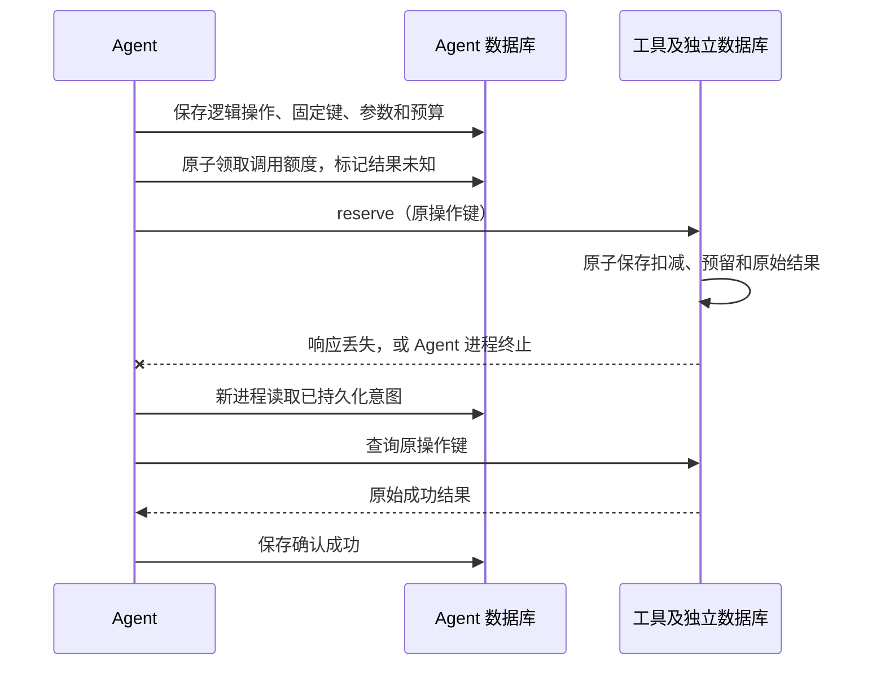

# L01 可运行练习：修复恢复后的重复副作用

学习路径：[Q027](../../questions/05-reliability.md#q027) → [G01](../../learning/guides/execution-recovery.md) → [L01 规范](../../learning/labs/recovery-after-tool-commit.md) → [M4 恢复验收](../../roadmap/milestones.md#m4)。

这里实现一个本地库存工具和 Agent 恢复器。每个用例从库存 10 开始；核心场景预留 2 件：错误对照在响应丢失后换键重试，库存降到 6；修复后沿用持久化的逻辑操作键，恢复后库存为 8、有效预留只有一条。边界用例另外检查库存不足、不同订单和未知结果。

这是合成练习参考实现，不连接任何真实库存、支付、模型或远程服务。所有库存、订单和日志均为模拟数据。

## 先运行，再检查原始记录

需要 Python 3.10+，并包含标准库 `sqlite3`。在仓库根目录运行，无第三方包：

```sh
python3 examples/l01_recovery/run.py
python3 -m unittest discover -s examples/l01_recovery -p "test_*.py" -v
```

两个命令运行同一组行为测试，任选一个即可；第一个附带结构化报告能力。每例使用新的临时目录，完成后清理；跨进程恢复在同一用例的持久化目录内进行，不依赖进程内存。

若要保存这次运行的原始证据，指定一个尚不存在的目录：

```sh
python3 examples/l01_recovery/run.py --output-dir .lab-output/l01-first-run
```

报告目录不能覆盖已有记录；再次运行请换一个目录名。`.lab-output/` 已被 Git 忽略，个人运行记录无需公开提交。失败用例会使命令返回非零退出码，不生成虚假的全通过结论。

本仓库留存一次 [2026-10-11 验收报告](verification/report.md) 与 [原始记录](verification/report.json)：21 项通过，0 失败、0 错误、0 跳过，包含真实子进程退出、双 worker 竞争和工具库锁超时。报告附三份源码的 SHA-256，可核对测的是哪一版；它是当次运行快照，后续代码变化需重新运行。CI 按提交执行测试，不自动改写这份存档。

`test_00` 是错误对照，它通过表示**确实复现了重复扣减**；其余用例验证修复和停止条件。不要把错误对照的 PASS 误读为库存 6 是正确业务结果。

## 这次修了什么

错误模式是把“网络请求”当成“业务操作”：第一次已经扣库存但响应丢失，第二次请求生成新键。工具无法识别两次请求属于同一个操作，再扣一次。

修复分成两个独立边界：

- **调用之前保存意图。** `AgentStore.prepare()` 将逻辑操作 ID、参数、操作键和总调用预算持久化。两个 worker 竞争创建时，最终都读取数据库实际保存的键；恢复不能改参数或重置预算。
- **工具端原子地去重。** `ToolStore.reserve()` 在一个事务中检查同键参数、扣库存、插入预留和保存原始结果。重复请求返回原始结果；同键不同参数拒绝。不同业务操作使用不同逻辑操作 ID，即使属于同一订单也不误合并。

Agent 的意图/检查点在 `agent.sqlite3`，工具的库存/结果账本在 `tool.sqlite3`。两者没有共享事务；本例刻意保留“工具已经提交、Agent 尚未保存成功”的故障窗口。



仅保存检查点无法替代工具端的契约；对不支持幂等和结果查询的模拟工具，本例停止未知结果的自动重试，转入核对。首次恢复在调用之前原子绑定下游契约；同一操作重启后切换幂等模式会抛出 `ContractConflict`，不发起新调用。否则，第一次非幂等调用已扣库存，重启误认为工具支持幂等时，仍可能再次扣减。

## 状态与预算

| 状态 | 含义 | 后续动作 |
| --- | --- | --- |
| `prepared` | 意图已保存，尚未领取外部调用额度 | 发起第一次调用 |
| `unknown` | 已领取调用额度，业务结果尚未确认 | 原键查询；在可靠幂等契约下才允许原键重试 |
| `succeeded` | 获得工具明确成功结果，并保存检查点 | 再次恢复直接读结果 |
| `failed` | 工具明确永久拒绝，例如库存不足 | 保存原因，结束自动尝试 |

调用前先标记未知，所以进程即使在真正发送之前终止，也保守地进入核对。`max_calls` 是自动远程调用的总次数预算，写请求和查询都计入；每次额度由数据库原子领取，跨重启和跨 worker 共用。

记录中的 `calls` 是已领取额度的次数，可能包括尚未发出就崩溃的请求；实际副作用以工具的 `reserve_applied` 事件、预留记录和库存共同核对，不能把调用次数当作扣减次数。

预算耗尽只记录 `halt_reason=budget_exhausted; reconcile_required`，不会把未知业务结果改成失败。新的恢复进程不能获得一份新预算。明确调用 `Agent.reconcile()` 可以执行额外的一次只读核对，单独记录 `manual_query`，不重置自动预算，也不发起新的业务写入。

迟到 worker 的超时或未知状态不能覆盖已经保存的成功。相反，如果收到与已确认终态矛盾的结果，示例抛出异常要求调查，不静默覆盖。

## 按 Q027 → G01 → L01 跟练

1. **先回答 Q027。** 不看实现，画出“工具事务提交”与“Agent 检查点保存”之间的间隙。预测换新键重试后库存是多少。
2. **读 G01，确认两个标识。** 逻辑操作 ID 标识一次业务意图；尝试 ID 标识一次调用。重启与换 worker 保留前者，每次请求有独立后者。
3. **运行 L01。** 对照错误用例的两条预留与修复用例的一条预留，查看操作键、调用类型、库存和状态，不只看 PASS。
4. **做一个变式。** 把数量改为 3：同一个操作不得改参数；新业务意图应使用新逻辑操作 ID。预测结果后再验证。
5. **解释停止条件。** 对比“已经提交但查询不可用”和“根本未提交且查询不可用”：Agent 看到相同超时，不能凭异常推断业务事实。

参考实现与实际运行记录属于仓库材料。学习者仍需自己运行、解释和处理变式，再填写 [项目证据模板](../../templates/project-evidence.md)；不自动获得能力档位或复习状态。

## M4 验收范围

| M4 条件 | 本例覆盖 | 尚需提供的内容 |
| --- | --- | --- |
| 工具成功、检查点未保存时恢复；同操作一次副作用，不同操作分别执行 | 本地工具、真实子进程退出、并发恢复及库存断言 | 自己项目中外部服务的实际契约及运行记录 |
| 模型或文档诱导跨租户时拒绝，检索不泄露其他租户内容 | **本例未验证** | [L03](../../learning/labs/retrieval-tenant-and-version.md) 与权限用例 |
| 重试耗尽可解释，未知不伪报成功，既有验收回归 | 本例的失败终态、未知结果、持久化预算及恢复回归 | 完整应用原有的 M1–M3 和权限回归 |

因此，L01 通过支持 **M4 恢复部分**的本地证据，不宣布 M4 整体通过。完整 M4 仍按原有三项验收收集证据。

## 文件与实现约定

- [recovery.py](recovery.py)：工具账本、意图/预算、恢复逻辑与显式故障点。
- [test_recovery.py](test_recovery.py)：错误对照、独立数据库、真实退出和并发行为测试。
- [run.py](run.py)：运行同一测试集并记录本次环境、实际输出和验收结果。

两个崩溃点在单独子进程中调用 `os._exit`，退出码分别为 71（工具提交后、响应前）和 72（响应返回后、保存检查点前），不会运行退出清理逻辑。并发测试的屏障位于工具事务之前，worker 使用各自连接，不把进程内锁当作工具幂等。

测试等待 worker 全部结束后记录结果。每个数据库的快照使用独立读事务；两份数据库之间没有全局原子快照。事件保留各自的序号和时间，不能仅凭时间戳推导跨服务的严格先后顺序。

工具账本在此练习中不删除幂等记录；没有演示保留期到期、异步排队、数据库丢失、跨地域一致性或网络协议实现。真实接入还需固定服务身份、契约版本和保留期。非幂等模式将每次写入视作新操作，恢复器只发起一次并保留未知，不能承诺自动恢复成功。

SQLite 的显式写事务负责本地模拟服务的原子性，写锁等待上限为 5 秒；工具锁超时会记录 `storage_locked; reconcile_required` 并抛出异常，保留未知结果。锁释放后的恢复仍查询原操作键。磁盘等其他数据库错误直接暴露，不伪报业务成功。相关机制见 [SQLite 事务说明](https://www.sqlite.org/lang_transaction.html) 与 [Python sqlite3 文档](https://docs.python.org/3/library/sqlite3.html)。这里没有跨任意外部服务的“恰好一次”保证。

[返回研习](../../learning/README.md) · [M4](../../roadmap/milestones.md#m4) · [恢复指南](../../learning/guides/execution-recovery.md)
