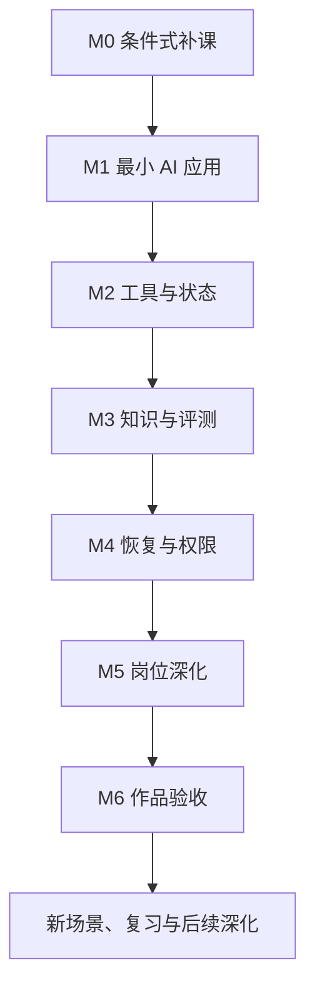

<!-- Generated by scripts/build.py. Edit data/*.json, then rebuild. -->

# 学习与成长路线

**内容类型：原创学习与成长规划** · 更新于 2026-10-12。

[路线总览](README.md) · [入口自测](start.md) · [能力阶段](milestones.md) · [学习与复习](review.md) · [面试前冲刺](interview-sprint.md) · [长期成长](growth.md) · [学习资料](resources.md)

用同一个项目逐步积累实现、验证和表达能力；题库作为自测入口，作品和失败记录作为成长证据。

1 个条件式补课阶段 · 6 个主线里程碑 · 4 个岗位分支 · 12 个岗位交付点。

本路线独立编写，以可观察的能力和交付证据推进。Q 是有来源的面试问题，G 是原创指南，L 是原创故障练习；路线与练习建议不增加面试题数量，也不代表企业统一要求。

## 从哪里开始

| 入口 | 适用情况 | 下一步 |
| --- | --- | --- |
| [先补编程与交付基础](start.md#foundation) | A1 或 A2 不能独立完成；完全零基础先走入门课程，再做 M0。 | [M0](milestones.md#m0)：只补自测暴露的依赖；A1/A2 达到 2 后转 AI 应用主线。 |
| [会开发，开始做 AI 应用](start.md#application) | A1/A2 均达到 2，并有独立完成证据；AI 调用、工具、知识、故障或评测仍有缺口。 | [M1](milestones.md#m1)：沿 M1–M4 补齐工程闭环，在 M5 只选一个岗位方向。 |
| [已有 AI 项目，复习与补强](start.md#review) | A1/A2 已独立完成，已有可复现 AI 链路，A5/A6 有故障与对照证据。 | [review](review.md)：先闭卷抽查和变式，再按各阶段验收补缺；有证据的阶段可以跳过。 |

先做[入口自测](start.md)，再按证据选择起点。M0 可以用等价工程证据跳过，已掌握的主线阶段也应先核对验收后再跳过。

## 能力如何累积

图中箭头表示能力前置关系；M0 是条件式补课，具有等价证据即可进入 M1。遇到失败按验收缺口回退，不按学习天数升级。

## 一直改进同一个项目

工单助手：把问题描述转为可检查的工单草稿，查询已有工单，检索处理规则，经授权后执行模拟业务操作。

一个小项目可以连续观察输入理解、工具选择、证据引用、状态恢复、用户权限与最终结果，便于比较前后版本。

每阶段只增加少量新能力。多 Agent、自训练和复杂部署按真实缺口引入；项目选择也可以替换，但应保留同类输入、状态、授权与结果验证条件。

## 用证据决定是否前进

先按每阶段三项验收提交已有证据，再决定从哪里开始。自评会背概念不能代替可运行产物或清晰的验证记录。

三个验收项都有证据后进入下一阶段；未通过的项目按回退建议缩小范围修复。通过不代表生产安全或企业录用。

产物状态：未开始、实现中、待验证、已验证、需返工。这些是记录标签，失败时可以回到“需返工”。

发生失败时记录预期、实际、最小复现与根因；回读相关 Q/G，修复后重跑对应 L 或项目回归，再用自己的话说明取舍。旧版本和失败记录保留，方便复习时检验理解是否改变。

M1–M6 主线的首次专注投入合计为 **104–208 小时**；若 M0 也全部需要，合计为 **128–268 小时**。

工时是编者对阅读、实现和首次调试的估计，不包含间隔复习、返工、等待、投递或零基础编程学习；不按累计工时自动通过，也不保证就业结果。

## 每周可用时间怎么分配

以下是可调整的时间预算示例，不是自动日历或统一完成期限。一个里程碑可以跨越多周，复习与验证也需要单独预留时间。

| 节奏 | 每周预算 | 活动分配 | 调整建议 |
| --- | --- | --- | --- |
| 轻量 | 4 小时 / 240 分钟 | 阅读与理解 40 分钟；实现与实验 120 分钟；主动复习 60 分钟；周末检查 20 分钟 | 一次只推动一个小产物，跨周完成里程碑；保留复习与验证。 |
| 常规 | 8 小时 / 480 分钟 | 阅读与理解 90 分钟；实现与实验 240 分钟；主动复习 120 分钟；周末检查 30 分钟 | 把实现分成两到四个完整时段，复习拆到不同日期。 |
| 集中 | 12 小时 / 720 分钟 | 阅读与理解 120 分钟；实现与实验 390 分钟；主动复习 150 分钟；周末检查 60 分钟 | 增加实验与复现时间，不同时开四条岗位路线；余量用于处理失败。 |

## 岗位选择

四个分支复用主线的工单/知识助手。进入M5时只选一个主岗位，完成该分支第一个交付点后返回主线作品验收；第二、第三交付点用于后续深化，不是当轮结课门槛，也不要求学完四个分支。

| 岗位 | 本轮最低交付点 | 深化目标 |
| --- | --- | --- |
| [AI 全栈](../paths/ai-fullstack.md) | [FS-1 · 让任务在页面里有完整生命周期](../paths/ai-fullstack.md#fs-1) | 证明用户能完成一次完整工作，而不只看到模型输出。 |
| [Agent 工程师](../paths/agent-engineer.md) | [AG-1 · 让执行过程可追踪、可拒绝、可结束](../paths/agent-engineer.md#ag-1) | 证明任务为什么成功、为什么失败，以及如何停止或恢复。 |
| [LLM 应用开发](../paths/llm-application.md) | [LLM-1 · 交付一个能核对的检索基线](../paths/llm-application.md#llm-1) | 区分找不到材料、材料不适用和模型用错材料。 |
| [Agent Infra](../paths/agent-infra.md) | [INF-1 · 交付一条可恢复的执行链](../paths/agent-infra.md#inf-1) | 证明故障后系统处于哪个状态、哪些动作可以重试以及容量边界在哪里。 |

## 使用边界

- 适用于 AI 全栈、Agent 工程、LLM 应用和 Agent Infra 入门到形成可讲解作品；不是模型训练研究岗位的完整课程。
- 默认已经能读写一种编程语言。完全没有编程经验者，先完成通用编程与调试入门，再做 M0；本路线不把这部分压缩进短期工时。
- 全程可以使用本地模拟数据与工具。模型接入可先用桩服务验证工程流程，但要把模拟结果与真实模型验证分开；没有真实模型验证时，不能声称模型效果已达标。
- L01–L04 均附本地参考实现、运行入口与实际合成验收记录。参考测试不代表学习者已独立掌握；模块通过不代表完整应用的阶段验收通过。未实际运行的个人验收项只能标为待验证。
- 每阶段的专注工时均为编者估计，包含阅读、实现和首次调试，不包括排队等待、投递或零基础编程学习；实际耗时取决于经验、项目范围与失败次数，不保证就业结果。

完整能力阶段见[主线](milestones.md)；完成一次作品后继续使用[复习方法](review.md)与[长期成长](growth.md)。面试临近时参考[冲刺示例](interview-sprint.md)。

[路线总览](README.md) · [入口自测](start.md) · [能力阶段](milestones.md) · [学习与复习](review.md) · [面试前冲刺](interview-sprint.md) · [长期成长](growth.md) · [学习资料](resources.md)

[返回题库](../README.md) · [学习计划模板](../templates/study-plan.md) · [项目证据模板](../templates/project-evidence.md)
